<div align="center">

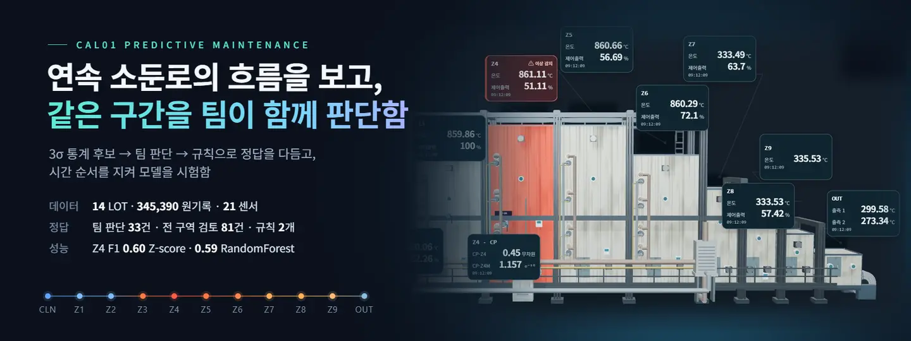

[](https://github.com/posco-3bungi-pdm/pdm-project/actions/workflows/ci.yml)
[](#정답을-일곱-번-다듬음-v1--v7)
[](#정답을-일곱-번-다듬음-v1--v7)
[](#구역별)
[](#구역별)
[](#시험-lot별)

[](https://cal01-monitor.onrender.com/)
[](https://cal01-review.onrender.com/)

<picture>
  <source media="(prefers-color-scheme: dark)" srcset="https://skillicons.dev/icons?i=python,sklearn,jupyter,django,react,ts,vite,threejs,electron,flask,postgres,docker,git,github&theme=dark">
  
</picture>

[작업 목록](https://github.com/posco-3bungi-pdm/pdm-project/issues) · [Pull requests](https://github.com/posco-3bungi-pdm/pdm-project/pulls) · [프로젝트 보드](https://github.com/orgs/posco-3bungi-pdm/projects/1) · [협업 안내](CONTRIBUTING.md) · [노트북 순서](notebooks/README.md) · [데이터 준비](data/README.md)

</div>

- 포스코 K-뉴딜 아카데미 3조 **오운완**<sub>(오늘 운전 완벽)</sub>의 설비 고장 예측 프로젝트임
- 연속 소둔로(CAL01) 한 대의 2024년 센서 기록에서 이상 후보를 찾고 팀이 함께 판단한 정답으로 모델을 시험한 뒤, 그 결과를 관제 화면까지 이어 붙임
- 데이터는 교육용 재현 데이터이며 실제 조업 데이터가 아님

## 바로 보기

<table>
<tr>
<th width="50%">관제 · CAL01 Monitor</th>
<th width="50%">공동 검토 · cal01-review</th>
</tr>
<tr>
<td>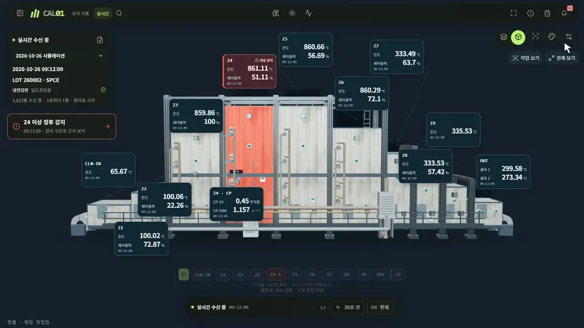</td>
<td>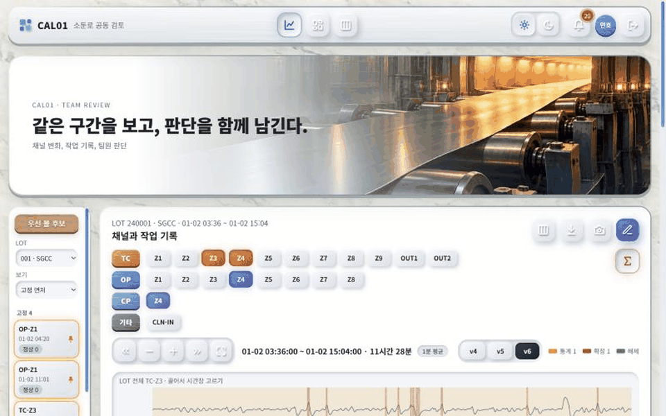</td>
</tr>
<tr>
<td>3D 소둔로 위에서 구역을 고르고 기록을 재생하며 Z-score 경보·채널 그래프·현장 요청을 한 화면에서 봄<br><a href="https://cal01-monitor.onrender.com/">cal01-monitor.onrender.com</a> · 저장소 <code>posco-3bungi-pdm/cal01-monitor</code></td>
<td>3σ 후보와 모델 후보를 LOT 그래프 위에 띄워 팀원이 1, 0, 보류를 남김. 판단은 검토 표가 되어 다음 정답으로 돌아옴<br><a href="https://cal01-review.onrender.com/">cal01-review.onrender.com</a> · 저장소 <code>posco-3bungi-pdm/cal01-review</code></td>
</tr>
</table>

- 두 사이트 모두 팀 계정으로 들어감
- 무료 서버라 15분 동안 쓰지 않으면 잠들고 다시 열 때 1분쯤 걸림

## 숫자로 보는 프로젝트

| 무엇 | 얼마나 |
| --- | --- |
| 설비, 기간 | 연속 소둔로 CAL01 한 대, 2024년 1월 ~ 12월 |
| LOT | 14개 (강종 7가지: SGCC, SPFH590, SPCE, SPCEN, SPHC, DP590, SPCD) |
| 기록 | 원기록 345,390행 (1초) → 1분 5,938행, 그중 정지·승온 321분 제외 |
| 센서 | 21개 (구역 온도 TC 11, 출력 OP 8, 가스 분위기 CP 1, 세정 입구 1) |
| 정답 | v1 → v7, 일곱 번 다듬음 |
| 검토 표 | 395행 (공통 움직임 해제 216, 팀 판단 33, 전 구역 검토 81, 모델 후보 60, 제안 5) |
| 모델 | Dummy, Z-score, IsolationForest, RandomForest × 구역 9개, 시험 LOT 10개 |

## 세 저장소, 한 흐름

<picture>
  <source media="(prefers-color-scheme: dark)" srcset="figures/readme/flow-dark.svg">
  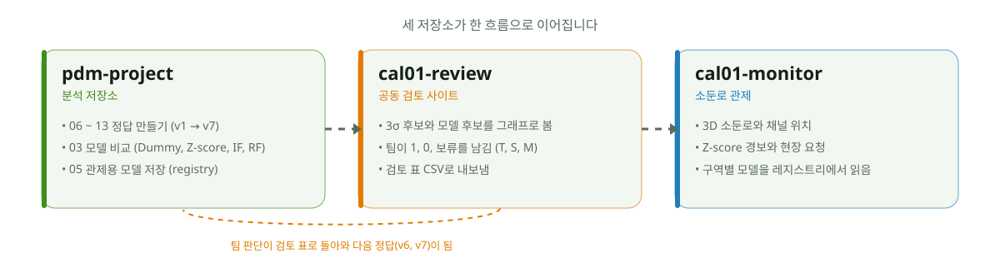
</picture>

| 저장소 | 하는 일 | 쓴 것 | 여기서 나가는 것 |
| --- | --- | --- | --- |
| `pdm-project` (이 저장소) | 정답 만들기(06 ~ 13), 모델 비교(03), 관제용 모델 저장(05) |  | `cal01_base_v1 ~ v7.csv`, `models/registry.json` |
| `cal01-review` | 후보를 그래프로 보고 팀이 판단 |  | `domain_decisions.csv` (검토 표) |
| `cal01-monitor` | 3D 소둔로, Z-score 경보, 현장 요청, 모델 레지스트리 |  | 팀 시연 |

## 데이터: 연속 소둔로 한 줄 흐름

- 강판은 세정 → 건조 → 예열 → 가열 → 균열 → 과시효 → 서냉 → 냉각 순으로 지나감
- 구역마다 온도(TC)와 가열 출력(OP)을 1초마다 기록하고 Z4에는 로 안 가스 분위기(CP)도 있음

| 구역 | 역할 | 센서 | 특징 |
| --- | --- | --- | --- |
| CLN | 세정 | CLN-IN | 출력 없음 |
| Z1, Z2 | 건조, 예열 | TC, OP | 둘이 같이 움직임 (5분 변화 상관 0.88) |
| Z3, Z4 | 가열 | TC, OP, CP(Z4) | Z3 변화가 2 ~ 5분 뒤 Z4 ~ Z6로 번짐. 팀 판단 1이 모두 여기 |
| Z5, Z6 | 균열 | TC, OP | Z3 ~ Z6 공통 움직임이 많음 |
| Z7, Z8 | 과시효 | TC, OP | 온도 변화 폭 0.3℃ 수준 |
| Z9, OUT | 서냉, 냉각 | TC | 다른 구역과 상관 0.3 미만 |

<details>
<summary>LOT 14개 (번호가 곧 시간 순서)</summary>

| LOT | 강종 | 날짜 | 분 | LOT | 강종 | 날짜 | 분 |
| --- | --- | --- | --- | --- | --- | --- | --- |
| 001 | SGCC | 1/2 | 689 | 069 | SPHC | 7/7 ~ 7/8 | 813 |
| 024 | SPFH590 | 3/7 ~ 3/8 | 548 | 091 | SPHC | 9/8 ~ 9/9 | 642 |
| 037 | SPCE | 4/13 ~ 4/14 | 612 | 108 | SPFH590 | 10/18 | 466 |
| 038 | SPCEN | 4/16 | 125 | 114 | SPCEN | 11/4 | 260 |
| 044 | SPHC | 5/3 | 75 | 117 | SPCD | 11/13 | 333 |
| 058 | DP590 | 6/9 | 154 | 121 | SPCE | 11/24 | 652 |
| 061 | SPHC | 6/15 | 140 | 133 | SPCE | 12/28 | 108 |

- 앞 4개 LOT(001, 024, 037, 038)은 학습에만 쓰고 나머지 10개가 시험 LOT임

</details>

- 센서 기록 옆에 조업 이벤트(강종 변경), 정비 이력, 부품 교체 이력, 정기 수리 달력을 같이 둠
- 정지와 승온 구간을 제외할 때와 이상이 정비와 이어지는지 볼 때 씀

## 정답을 일곱 번 다듬음 (v1 → v7)

<picture>
  <source media="(prefers-color-scheme: dark)" srcset="figures/readme/labels-dark.svg">
  
</picture>

| 버전 | 단위 | 이상 1을 붙이는 법 | 노트북 |
| --- | --- | --- | --- |
| v1 | 1초 | 같은 LOT 평균에서 3σ 넘게 벗어나면 1 (통계 후보) | 06 |
| v2, v3 | 1초 | 여러 구역이 같이 움직인 곳은 팀이 보고 0으로 해제 (C, E, J, A 216건) | 07, 08 |
| v4, v5 | 1분 | v2, v3를 1분으로 묶음 | 09, 10 |
| v6 | 1분 | v5 + 팀 판단 T 29건 (1은 14건) + 전 구역 검토 S 80건 (모두 0) | 11 |
| v7 | 1분 | v6 + 모델 후보 M 60건 판단 + 규칙 2개 | 12, 13 |

- 모델이 맞혀야 하는 정답은 **팀 판단이 있으면 팀 판단, 없으면 통계 후보**임
- 검토 내용은 `data/labels/domain_decisions.csv` 한 곳에 모음(CSV라 저장소에는 없고 팀 공유 경로로 주고받음)

- v7의 규칙 2개는 팀이 네 번 내린 판단(출력 움직임은 정상 제어)을 전 구역에 같은 기준으로 적용한 것임

| 규칙 | 뜻 | 근거 |
| --- | --- | --- |
| 출력만 넘음 | 출력(OP)이 3σ를 넘어도 온도와 CP가 안 넘었으면 정상 제어로 0 | 통계 후보 1의 대부분이 출력 5 ~ 8%p 움직임 (Z5 577분 중 564분) |
| 온도 0.5℃ 미만 | 온도가 3σ를 넘어도 LOT 평균에서 0.5℃ 미만 벗어났으면 측정 잡음으로 0 | Z7, Z8 후보의 벗어난 폭이 0.3℃ |

## 모델에 넣는 입력 (묶음 7개)

- 모든 값은 같은 LOT 안에서 지금보다 앞선 분의 값만 씀
- 미래 값은 입력에도 통계에도 쓰지 않음

| 묶음 | 쉬운 뜻 | 03에서 이 컬럼 묶음을 넣는 설정 |
| --- | --- | --- |
| 기본 | 내 구역 센서의 1분 평균, 바로 앞 분과의 차이, 1분 안 최소·최대·표준편차 | 항상 |
| 공통 움직임 | 같은 그룹(Z1·Z2, Z3 ~ Z6, Z7·Z8) 온도의 5분 변화, 내 구역 말고 최근 5분 안에 3σ 넘은 온도 수 | `USE_COMMON` |
| 10분 이동통계 | 직전 10분 평균과의 차이, 직전 10분 표준편차 | `USE_ROLL10` |
| 지난 값 Z | 지금까지 본 값의 평균·표준편차로 잰 \|Z\| (Z-score 기준선과 같은 계산) | `USE_ZPAST` |
| OP 공통 움직임 | 공통 움직임을 출력으로 | `USE_OPCOMMON` |
| 로 전체 동시 이상 | Z1 ~ Z8 중 내 구역 말고 최근 5분 안에 3σ 넘은 구역 수 | `USE_FURNACE` |
| 제어 어긋남 | 최근 5분 동안 온도와 출력이 같은 방향으로 움직인 비율 (정상 제어면 반대 방향) | `USE_CONTROL` |

- 포화비율, 경과시간, 변화율, 강종 계열 컬럼 5묶음도 실험했지만 여러 구역에서 함께 좋아지지 않아 꺼 둠

## 모델 설계: 시간 순서를 지키는 시험

<picture>
  <source media="(prefers-color-scheme: dark)" srcset="figures/readme/walkforward-dark.svg">
  
</picture>

| 모델 | 역할 | 점수 읽는 법 |
| --- | --- | --- |
| Dummy (전부 0) | 바닥 점수 | 정확도는 90%가 넘지만 F1은 0. 정확도 대신 F1을 쓰는 이유 |
| Z-score (지난 값) | 현장 규칙 기준선. 지금까지의 평균에서 3σ 넘으면 경보 | 정답이 3σ로 만들어져 처음엔 가장 높고 팀 판단이 들어갈수록 내려감 |
| IsolationForest | 정답 없이 평소와 다른 분을 찾음 (비지도) | F1로는 불리. 후보 뽑기와 팀 판단 대조에 씀 |
| RandomForest | 정답(통계 후보 + 팀 판단)을 배워 따라 함 (지도) | 팀 판단이 있는 구역에서 Z-score를 넘으면 "팀 판단을 배웠다"는 뜻 |

- RandomForest는 나무 100개, 깊이 10, `class_weight="balanced"`, `random_state=42` 고정임
- 구역마다 모델을 따로 만듦
- 저장할 때는 `cal01-<정답 버전>-<입력 태그>-<구역>-<모델>-<학습 범위>-<날짜>` 이름으로 레지스트리에 적음

<details>
<summary>발표 자료의 모델 설계 장면 (모핑)</summary>


</details>

## 결과

- 점수는 "팀이 다듬은 정답을 모델이 얼마나 재현하나"임
- 실제 고장을 예측한 성능이 아님

### 구역별

<picture>
  <source media="(prefers-color-scheme: dark)" srcset="figures/readme/zone_f1-dark.png">
  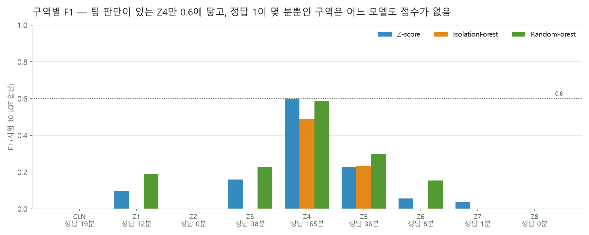
</picture>

| 구역 | 정답 1 (분) | Z-score | IsolationForest | RandomForest | 읽는 법 |
| --- | --- | --- | --- | --- | --- |
| Z4 | 165 | **0.598** | 0.489 | 0.585 | 팀 판단 1(CP)이 있는 구역. 세 모델이 가까워짐 |
| Z3 | 38 | 0.160 | 0 | 0.226 | 남은 정답은 T08(16분)과 온도 튐 |
| Z5 | 36 | 0.228 | 0.234 | 0.299 | |
| Z1 | 12 | 0.097 | 0 | 0.190 | |
| Z6 | 8 | 0.057 | 0 | 0.154 | |
| Z2, Z7, Z8 | 0, 1, 0 | – | – | – | 0.5℃ 넘는 온도 이상이 없음. 헛경보 수로 보고 (RF 2, 0, 0) |
| CLN | 19 | 0 | 0 | 0 | LOT 069의 19분 묶음을 세 모델 다 놓침 |

### 시험 LOT별

- 구역 합산 F1과 함께, LOT 하나를 시험했을 때의 점수도 봄
- LOT의 F1은 그 LOT에 정답 1이 있는 구역들의 F1 평균이고 전체는 그 평균의 평균임

<picture>
  <source media="(prefers-color-scheme: dark)" srcset="figures/readme/lot_f1-dark.png">
  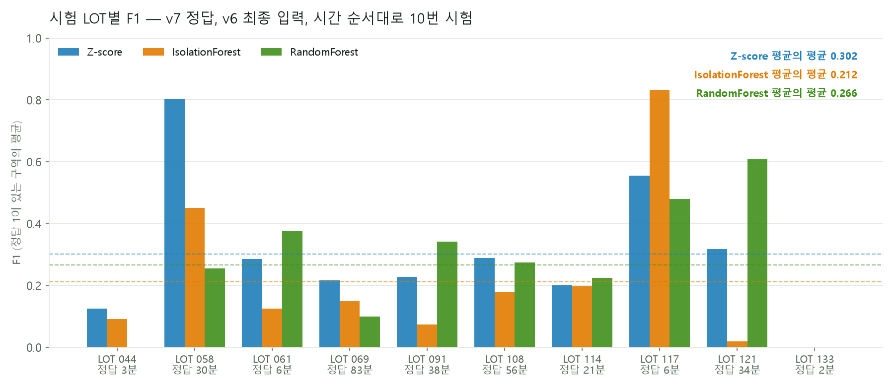
</picture>

| | Z-score | IsolationForest | RandomForest |
| --- | --- | --- | --- |
| 평균의 평균 (시험 LOT 10개) | 0.302 | 0.212 | 0.266 |

- 정답 1이 2 ~ 3분뿐인 LOT(044, 133)과 구역(Z6 8분, Z1 12분)이 Z4(165분)와 같은 무게로 들어가므로 평균의 평균은 낮게 나옴
- 어느 칸이 비었는지는 아래 그림이 보여 줌

<picture>
  <source media="(prefers-color-scheme: dark)" srcset="figures/readme/heatmap-dark.png">
  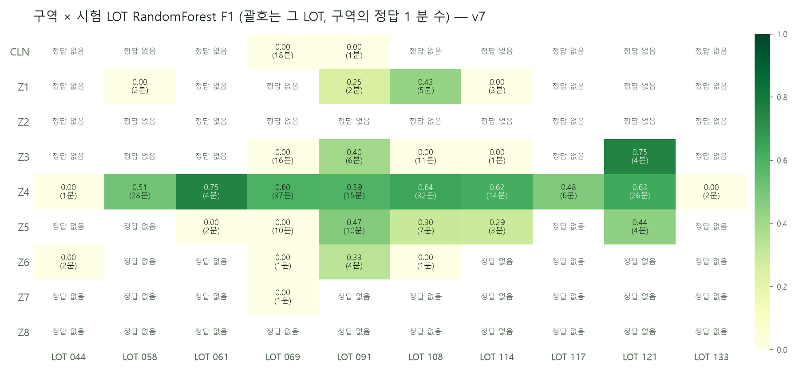
</picture>

<details>
<summary>Z4를 시험 LOT별로</summary>

| 시험 LOT | 정답 1 (분) | Z-score | IsolationForest | RandomForest |
| --- | --- | --- | --- | --- |
| 044 | 1 | 0.25 | 0.18 | 0 |
| 058 (T12) | 28 | 0.81 | **0.90** | 0.51 |
| 061 (T31) | 4 | 0.57 | 0.25 | **0.75** |
| 069 (T01 ~ T08) | 37 | **0.65** | 0.48 | 0.60 |
| 091 (T32) | 15 | 0.50 | 0.26 | **0.59** |
| 108 | 32 | 0.57 | 0.56 | **0.64** |
| 114 | 14 | 0.58 | 0.50 | **0.62** |
| 117 (T11) | 6 | 0.56 | **0.83** | 0.48 |
| 121 | 26 | 0.50 | 0.06 | **0.63** |
| 133 | 2 | 0 | 0 | 0 |

- RandomForest가 10개 중 5개 LOT에서 1등, IsolationForest 2개, Z-score 1개
- 정답 1이 1 ~ 2분뿐인 LOT에서는 어느 모델도 점수가 안 나옴

</details>

- **배운 것**

- 점수를 올린 것은 컬럼이 아니라 정답이었음. 공통 움직임을 해제하고 팀 판단을 넣은 Z3 ~ Z6에서만 RandomForest가 Z-score를 넘음.
- 통계 후보(3σ) 1의 대부분은 출력 움직임이거나 0.3℃ 튐이었음. 규칙으로 걷어 내자 Z2, Z7, Z8에는 이상이 남지 않았고 Z3 ~ Z6의 이전 점수가 출력 움직임을 맞힌 몫이었음이 드러남.
- 모델 설정(나무 깊이, 문턱, 지연 입력)이나 모델 교체(HistGradientBoosting)로는 ±0.03 안에서만 움직임. 팀이 확정한 이상이 없는 구역은 F1 대신 헛경보 수로 말함.

## 데이터가 정비 기록과 만나는 곳

- LOT 069의 CP-Z4 한 줄을 CSV 값 그대로 그린 것임
- 선이 끝까지 그려진 뒤 켜지는 구간이 팀이 1로 확정한 T01이고 그 2시간 뒤에 정비 기록이 있음

<picture>
  <source media="(prefers-color-scheme: dark)" srcset="figures/readme/lot069-cp-dark.svg">
  
</picture>

- 2024년 한 해로 넓히면 CP가 튄 LOT 뒤에 정비가 따라온 짝이 네 번 있음

<picture>
  <source media="(prefers-color-scheme: dark)" srcset="figures/readme/domain-dark.svg">
  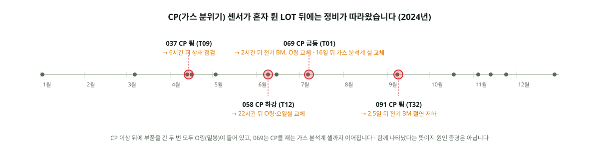
</picture>

| 팀 판단 | CP가 튄 LOT | 뒤따른 정비 | 부품 교체 |
| --- | --- | --- | --- |
| T01 | 069 (7/8) | 2시간 뒤 전기 BM 절연 저하, 405분 정지 | O링 세트. 16일 뒤 가스 분석계 셀(손상) |
| T12 | 058 (6/9) | 22시간 뒤 점검, 55시간 뒤 마모량 초과 | 오일씰(수명), O링 세트(손상) |
| T09 | 037 (4/14) | 6시간 뒤 상태 점검 "확인 중" | 없음 |
| T32 | 091 (9/9) | 2.5일 뒤 전기 BM 절연 저하 | 없음 |

- CP는 로 안 가스 분위기를 재는 센서라 밀봉(O링)과 CP 센서 자체(가스 분석계 셀)로 이어짐
- 다만 함께 나타났다는 뜻이지 원인을 증명한 것은 아님

## 다음에 할 일

- 팀 확인: v7 규칙 2개, 모델 후보 60건의 "AI 제안" 판단, T32·T33
- 정비 앞에 있었지만 아직 팀이 보지 않은 온도 묶음: 069 CLN 19분, 069 Z5 11분, 037 CLN 13분, 108 Z3·Z4
- 규칙이 확정되면 05 노트북으로 v7 모델을 저장해 관제에 올림
- 03에 사건 단위 지표(확정 구간 안에서 울렸나, 밖에서 몇 번 울렸나) 추가

## 실행 방법 (처음 하는 사람용)

- 컴퓨터를 처음 다루는 사람도 따라갈 수 있게 순서대로 적음
- 윈도우 PC 기준이고 다 하면 30분쯤 걸림

- **준비물 세 가지**

| 준비물 | 어디서 받나 | 잘 됐는지 확인 |
| --- | --- | --- |
| Python 3.14 | [python.org/downloads](https://www.python.org/downloads/)에서 받아 설치. 설치 첫 화면 아래의 **Add python.exe to PATH**에 꼭 체크 | PowerShell에 `py -3.14 --version`을 치면 `Python 3.14.x`가 나옴 |
| Git | [git-scm.com](https://git-scm.com/download/win)에서 받아 설치. 전부 기본값으로 "다음" | `git --version`을 치면 버전이 나옴 |
| 데이터 | 팀 공유 폴더의 원본 CSV 8개와 검토 표 1개. 저장소 안에는 없음 (팀장에게 요청) | 아래 4번에서 씀 |

- **1. PowerShell 열기**
  - 시작 메뉴에서 "PowerShell"을 검색해 열면 글자만 있는 파란 창이 뜸
  - 아래 명령은 모두 이 창에 한 줄씩 붙여 넣고 Enter를 치면 됨
  - `#` 뒤는 설명이라 같이 붙여 넣어도 괜찮음

- **2. 저장소 가져오고 파이썬 도구 설치하기**
  - 저장소는 프로젝트 파일이 전부 들어 있는 폴더라고 생각하면 됨

```powershell
cd ~\Documents                                                        # 내 문서 폴더로 이동
git clone https://github.com/posco-3bungi-pdm/pdm-project.git          # 저장소 폴더를 통째로 내려받음
cd pdm-project                                                         # 그 폴더 안으로 들어감
py -3.14 -m venv .venv                                                 # 이 프로젝트만 쓰는 파이썬 방(.venv)을 만듦
.\.venv\Scripts\python.exe -m pip install --upgrade pip                 # 설치 도구 pip을 최신으로
.\.venv\Scripts\python.exe -m pip install -r requirements.txt -r requirements-ci.txt   # 필요한 꾸러미 전부 설치 (5 ~ 10분)
.\.venv\Scripts\python.exe -m nbstripout --install --attributes .gitattributes          # 노트북 실행 결과가 Git에 안 올라가게 설정
.\.venv\Scripts\python.exe .github/scripts/check_repository.py                          # 저장소 검사. PASS가 나오면 준비 끝
```

- `.venv`를 "활성화"하는 명령은 쓰지 않음
- 윈도우 보안 설정에 막히는 일이 많아서 그 방의 `python.exe`를 매번 직접 부르는 방식으로 적어 둠

- **3. 잘 됐는지 확인하기**

```powershell
.\.venv\Scripts\python.exe -c "import pandas, sklearn; print('준비 완료')"
```

- `준비 완료`가 찍히면 성공임

- **4. 데이터 넣기**
  - 팀 공유 폴더에서 받은 파일을 아래 자리에 복사해 넣음
  - 파일 이름은 바꾸지 않음
  - 파일 목록은 [data/README.md](data/README.md)에 있음

| 받은 것 | 넣는 자리 |
| --- | --- |
| 원본 CSV 8개 | `data/raw/` (또는 `data/`) |
| 검토 표 `domain_decisions.csv` | `data/labels/` |

- **5. 노트북 열고 정답 CSV 만들기**

```powershell
.\.venv\Scripts\python.exe -m jupyter lab
```

- 브라우저가 저절로 열림
- 왼쪽 파일 목록에서 `notebooks/namelesspark/06_cal01_base_v1.ipynb`를 열고 위 메뉴 **Run → Run All Cells**를 누름
- 끝나면 `07`, `08`, ... `13`까지 번호 순서대로 하나씩 똑같이 함
- 다 끝나면 `data/processed/cal01_base_v7.csv`가 생김

- **6. 모델 점수 보기**
  - `notebooks/sayletskin/03_model_f1.ipynb`를 열어 위쪽 칸의 `DATA_FILE`(어느 정답 CSV를 쓸지)과 `ZONE`(어느 구역을 볼지)만 바꾸고 Run All Cells
  - 맨 아래에 세 모델의 F1이 표로 나옴

- **막히면**

| 이런 말이 나오면 | 뜻 | 이렇게 |
| --- | --- | --- |
| `py : 용어 ... 인식되지 않습니다` | 파이썬이 없거나 설치할 때 PATH에 체크를 안 함 | 파이썬을 다시 설치하면서 PATH에 체크. PowerShell도 새로 열기 |
| `git : 용어 ... 인식되지 않습니다` | Git이 없음 | Git을 설치한 뒤 PowerShell 새로 열기 |
| `FileNotFoundError: ... data/raw/...` | 데이터 파일이 자리에 없음 | 4번처럼 파일을 넣고 이름이 맞는지 확인 |
| 설치가 너무 오래 걸림 | 꾸러미가 많음 | 10분까지는 정상임. 인터넷이 끊겼으면 `pip install` 줄만 다시 실행 |
| 노트북이 빨간 글을 내고 멈춤 | 앞 번호 노트북의 CSV가 아직 없음 | 06부터 번호 순서대로 다시 실행 |

- README 그림을 다시 만들 때는 `figures/readme/make_readme_svg.py`, `make_readme_charts.py`, `make_readme_data_svg.py`를 차례로 실행함
- 맨 위 배지의 숫자는 `figures/readme/metrics.json`에서 읽어 오므로 03 노트북 결과가 바뀌면 그 파일만 고치면 됨

```text
.github/     Issue·PR 양식, 자동 검사와 자동 배정
data/        데이터 확보 안내 (원본과 CSV는 Git에 올리지 않음)
docs/        문제 정의, 데이터 계약, 실험·의사결정 기록
notebooks/   정답 만들기(namelesspark), 모델 비교(sayletskin), 탐색(jinny)
models/      관제용 모델 저장 규칙 (파일은 Git에 올리지 않음)
figures/     검토된 그래프와 README 그림
src/, tests/ 재사용 코드와 테스트
```

## 보고서

- [결과보고서](reports/결과보고서.md)
- [시계열 분석 보고서 PDF](<reports/CAL01_소둔로 시계열 분석 보고서(3조 오운완).pdf>)
- [실험 기록](docs/03-experiment-log.md)
- [제출 PDF 목록](reports/README.md)

## 팀과 규칙

- 3조 오운완<sub>(오늘 운전 완벽)</sub>: 김태구(팀장), 김정렬, 박민호, 정수진, 황유진

- **Issue → 작업 브랜치 → PR → CI → 동료 3명 승인 → Squash merge**
- `main`은 함께 검토한 결과만 모으고 원본 데이터·CSV·모델 파일·비밀값은 올리지 않음
- 자세한 규칙은 [CONTRIBUTING.md](CONTRIBUTING.md), 자동화는 [docs/automation.md](docs/automation.md)에 있음

- 행 수와 독립 표본 수를 구분하고 분석 단위(LOT, 1분)를 먼저 정함.
- 시간 순서로 나누고 통계와 전처리는 지나간 값에만 적용함.
- 단순 기준선(Z-score)과 모델을 같은 조건에서 비교함.
- 팀이 확정한 정답이 없는 구역에서는 F1을 주장하지 않음.
- 결과에는 판단 근거, 경계 사례, 헛경보 가능성, 현장 적용 한계를 함께 적음.
